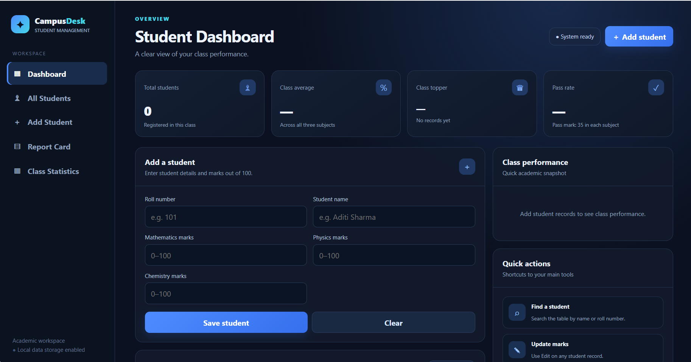

# ⚡ STUDENT MANAGEMENT SYSTEM

### `SMART RECORDS. SIMPLE WORKFLOWS. C++ POWER.`

<p align="center">
  
  
  
  
</p>

<p align="center">
  A beginner-friendly student record management project combining a menu-driven C++ program with a web interface hosted on GitHub Pages.
</p>

<p align="center">
  <a href="https://rajaryansharma56-dot.github.io/student-management-system/">
    
  </a>
  <a href="https://github.com/rajaryansharma56-dot/student-management-system">
    
  </a>
</p>

---

## 🖥️ APPLICATION PREVIEW

<p align="center">
  
</p>

<p align="center">
  <i>A preview of the project's web interface.</i>
</p>

---

## 🎯 ABOUT THE PROJECT

The **Student Management System** is a programming project focused on organizing student information and exploring simple academic record management workflows.

The project contains two components:

- **C++ application:** A console-based program for managing student records.
- **HTML interface:** A browser-based interface published using GitHub Pages.

This project demonstrates practical use of programming fundamentals, arrays, loops, conditional statements, user input, and basic web development.

> **Architecture note:** The C++ program and the hosted HTML interface currently operate independently. The web interface does not automatically access the C++ program's data.

---

## ✨ KEY FEATURES

### 💻 C++ APPLICATION

- ➕ **Add Student** — enter student details and subject marks.
- 📋 **Display Records** — view student information stored during the program's execution.
- 🔍 **Search Student** — find a student using a roll number.
- 📊 **Academic Information** — organize marks for Mathematics, Physics, and Chemistry.
- 🔄 **Menu-Driven Navigation** — select operations through a simple console menu.

### 🌐 WEB INTERFACE

- Browser-accessible HTML page.
- Public live demo hosted with GitHub Pages.
- Shareable website link for demonstrations and project reviews.

*Features listed above describe the intended C++ workflow and web interface. Their availability depends on the implementation in each component.*

---

## ⚙️ TECHNOLOGY STACK

| Technology | Role |
|:--|:--|
| **C++** | Console application and student record logic |
| **HTML5** | Web interface |
| **Git** | Version control |
| **GitHub** | Source code hosting |
| **GitHub Pages** | Static website deployment |

---

## 🏗️ PROJECT STRUCTURE

```text
student-management-system/
│
├── index.html
├── student_management.cpp
├── student-management-preview.png
├── README.md
└── LICENSE
```

---

## 🚀 GETTING STARTED

### 1. Clone the repository

```bash
git clone https://github.com/rajaryansharma56-dot/student-management-system.git
```

### 2. Open the project folder

```bash
cd student-management-system
```

### 3. Compile the C++ application

Make sure a C++ compiler such as GCC or MinGW is installed.

**Windows (MinGW):**

```bash
g++ student_management.cpp -o student_management
student_management.exe
```

**Linux / macOS:**

```bash
g++ student_management.cpp -o student_management
./student_management
```

### 4. Open the web interface

Open `index.html` in your browser, or use the deployed website:

**[Open Live Demo →](https://rajaryansharma56-dot.github.io/student-management-system/)**

---

## 🧠 CONCEPTS PRACTICED

- Arrays and indexed data storage
- Loops and conditional logic
- Menu-driven program design
- User input and console output
- Basic HTML page development
- GitHub repository management
- Static website deployment

---

## 🔭 FUTURE ROADMAP

Potential improvements for future versions:

- [ ] Edit and delete student records
- [ ] Input validation and duplicate roll-number checks
- [ ] Persistent storage using files or a database
- [ ] Automatic calculation of totals, percentages, and grades
- [ ] Responsive and more interactive web interface
- [ ] Integration between the C++ backend and web frontend
- [ ] Student performance dashboard and analytics

---

## 👨‍💻 DEVELOPER

**Raj Aryan Sharma**

Electronics & Instrumentation Engineering

**Interests:** C++ · Data Structures & Algorithms · Python · Electronics · Robotics

<p align="left">
  <a href="https://github.com/rajaryansharma56-dot">
    
  </a>
</p>

---

## 📜 LICENSE

Refer to the [`LICENSE`](./LICENSE) file for the licensing terms applicable to this project.

---

<p align="center">
  <b>BUILD • LEARN • IMPROVE</b>
  <br/>
  <sub>A practical step forward in software development.</sub>
</p>
